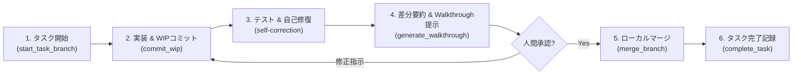

# ローカル開発ワークフロー規定 (Local Task Workflow)

本ドキュメントは、GitHub PR やリモート連携を使用せず、ローカル環境単体で安全かつ確実に開発サイクル（タスク文書管理、作業ブランチ運用、テスト自己修復、人間承認後のマージ、タスク完了記録）を推進するためのワークフローである。

> [!IMPORTANT]
> - **成果物言語**: AIが作成する成果物ドキュメント（Implementation Plan、Walkthrough、タスク文書等）は、原則として**日本語**で記述すること。
> - **調査と実装の分離**: ユーザー指示が「確認・調査」である場合はコードやドキュメントを変更せず結果報告に留めること。変更作業は、事前に明示的な修正指示と実装計画の承認を得てから作業ブランチ上で行うこと。
> - **Ponytail原則**: 仕様書にない不要な抽象化や過剰なボイラープレートを排除し、最短・最善の最小差分で実装すること。
> - **承認なきマージの禁止**: テストが全件通過しても、**チャット上で人間にWalkthroughを提示して明示的なマージ承認を得る前に、勝手にbaseブランチへマージしてはならない (**MUST NOT**)。**

---

## ワークフロー全体図 (Local Lifecycle Overview)



---

## 1. タスク開始と作業ブランチ作成

* **タスク文書の初期化とブランチ作成**:
  * 専用スクリプトを実行し、`docs/tasks/<task>.md` の生成（初回は `docs/tasks/` も自動作成）と作業ブランチの作成・チェックアウトを一括実行する。
  ```bash
  python .agents/skills/local-workflow/scripts/start_task_branch.py -t 001-task-name --title "タスクの日本語タイトル"
  ```
* **タスク仕様の明確化**:
  * 生成された `docs/tasks/<task>.md` 内の Goal、Context、Technical Details、Verification を確認・補完する。

---

## 2. 実装とWIPコミット（セーブポイント）

* **安全なWIPコミット**:
  * 作業ブランチ上での自律的なWIPコミットは許可される。機密情報漏洩を100%機械的に阻止するため、必ず専用スクリプトを使用すること。
  ```bash
  python .agents/skills/local-workflow/scripts/commit_wip.py -m "作業内容の説明" -t 001-task-name
  ```

---

## 3. 自律テスト・品質検証と自己修復 (Self-Correction)

* **自律的な品質検証**:
  * コード修正後、プロジェクト固有の標準テストおよびLinter（`npm test`, `pytest`, `cargo test` 等）を自律判定して実行する。
* **自己修復プロトコル**:
  * エラー発生時は最大3回まで自律修復を試みる。巨大ログ抑制テクニックや詳細な手順は [**references/self-correction.md**](references/self-correction.md) を参照すること。

---

## 4. 成果物確認と人間へのマージ承認要請

* **差分サマリー抽出**:
  ```bash
  python .agents/skills/local-workflow/scripts/generate_walkthrough.py
  ```
* **チャット上でのWalkthrough提示と承認確認**:
  * 差分要約を元に、概要・変更点・検証結果をチャットに報告する。
  * **「実装と検証が完了しました。baseブランチ（main）へのマージを進めてよろしいですか？」** と人間に確認する。

---

## 5. 承認後マージとタスク完了処理

人間からチャット上で承認（「マージして」「OK」等）を受けた後、以下のステップを順次実行する。

1. **ローカルマージとブランチ削除**:
   ```bash
   python .agents/skills/local-workflow/scripts/merge_branch.py -b task/001-task-name
   ```
2. **タスク文書の完了移動**:
   ```bash
   python .agents/skills/local-workflow/scripts/complete_task.py -t 001-task-name.md
   ```
   * ステータスが `🟢 完了` に更新され、`docs/tasks/completed/` に移動される。
   * 詳細なライフサイクル運用は [**references/local-lifecycle.md**](references/local-lifecycle.md) を参照すること。
