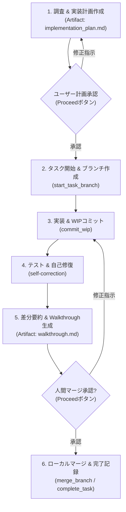

# ローカル開発ワークフロー規定 (Local Task Workflow)

本ドキュメントは、GitHub PR やリモート連携を使用せず、ローカル環境単体で安全かつ確実に開発サイクル（タスク文書管理、作業ブランチ運用、テスト自己修復、人間承認後のマージ、タスク完了記録）を推進するためのワークフローである。

> [!IMPORTANT]
> - **成果物言語**: AIが作成する成果物ドキュメント（Implementation Plan、Walkthrough、タスク文書等）は、原則として**日本語**で記述すること。
> - **調査と実装の分離**: ユーザー指示が「確認・調査」である場合はコードやドキュメントを変更せず結果報告に留めること。
> - **不可侵ガードレール（ブランチ保護）**: コードや仕様書を1文字でも編集する前に、必ず作業ブランチに切り替えること (**MUST**)。baseブランチ（`main` 等）上での直接編集・直接コミットは絶対禁止 (**MUST NOT**)。
> - **Artifacts原則**: 実装計画書（`implementation_plan.md`）および完了報告（`walkthrough.md`）は必ず Antigravity Artifacts ディレクトリ（`<appDataDir>\brain\<conversation-id>\`）に出力し、チャット本文への長大な全文再要約・二重出力を禁じる (**MUST NOT**)。
> - **Ponytail原則**: 仕様書にない不要な抽象化や過剰なボイラープレートを排除し、最短・最善の最小差分で実装すること。
> - **承認なきマージの禁止**: テストが全件通過しても、人間にWalkthroughを提示して明示的なマージ承認（Proceedボタンまたはチャット承認）を得る前に、勝手にbaseブランチへマージしてはならない (**MUST NOT**)。

---

## ワークフロー全体図 (Local Lifecycle Overview)



---

## 1. 調査と実装計画書（Artifact: implementation_plan.md）

* **調査と要求分析**:
  * 関連仕様書（`docs/spec-router.md`）やコードを調査し、変更対象と受入条件を特定する。
* **実装計画書の Artifact 出力**:
  * `write_to_file` を用い、`<appDataDir>\brain\<conversation-id>\implementation_plan.md` に計画書を作成する。
  * `ArtifactMetadata` には `UserFacing: true`, `RequestFeedback: true` を指定し、UI上に「Proceed」ボタンを表示させる。
* **チャット案内ルール**:
  * チャット本文で計画全文を再要約せず、Artifact へのファイルリンクと判断・確認が必要な論点のみを簡潔に提示してユーザーの承認を仰ぐ。

---

## 2. タスク開始と作業ブランチ作成

* **タスク文書の初期化とブランチ作成 (MUST)**:
  * 計画承認後直ちに専用スクリプトを実行し、`docs/tasks/<task>.md` の生成（初回は `docs/tasks/` も自動作成）と作業ブランチの作成・チェックアウトを一括実行する。
  * **タイトル規約**: タイトルに `[AI]` や絵文字等の接頭辞（Prefix）は付けず、クリーンな日本語タイトルとする (**MUST**)。
  * **AI識別ラベル**: 生成されるタスク文書の Frontmatter に `labels: ["ai-generated"]` が含まれる (**MUST**)。
  * **共通フッター**: 本文末尾に共通免責フッターを含める (**MUST**)。
  ```bash
  python .agents/skills/local-workflow/scripts/start_task_branch.py -t 001-task-name --title "タスクの日本語タイトル"
  ```
* **タスク仕様の明確化**:
  * 生成された `docs/tasks/<task>.md` 内の Goal、Context、Technical Details、Verification を確認・補完する。

---

## 3. 実装とWIPコミット（セーブポイント）

* **安全なWIPコミット**:
  * 作業ブランチ上での自律的なWIPコミットは許可される。機密情報漏洩を100%機械的に阻止するため、必ず専用スクリプトを使用すること。
  ```bash
  python .agents/skills/local-workflow/scripts/commit_wip.py -m "作業内容の説明" -t 001-task-name
  ```

---

## 4. 自律テスト・品質検証と自己修復 (Self-Correction)

* **自律的な品質検証**:
  * コード修正後、プロジェクト固有の標準テストおよびLinter（`npm test`, `pytest`, `cargo test` 等）を自律判定して実行する。
* **自己修復プロトコル**:
  * エラー発生時は最大3回まで自律修復を試みる。巨大ログ抑制テクニックや詳細な手順は [**references/self-correction.md**](references/self-correction.md) を参照すること。

---

## 5. 差分要約とWalkthrough（Artifact: walkthrough.md）

* **差分サマリー抽出**:
  ```bash
  python .agents/skills/local-workflow/scripts/generate_walkthrough.py
  ```
* **Walkthrough の Artifact 出力**:
  * 差分要約およびテスト実行エビデンス（PASSログ）を統合し、`<appDataDir>\brain\<conversation-id>\walkthrough.md` を作成する（`UserFacing: true`, `RequestFeedback: true` でマージ承認を要請）。
  * チャット上ではエビデンス概要とリンクのみを提示し、マージ確認を求める。

---

## 6. 承認後マージとタスク完了処理

人間から承認（Proceedボタンまたはチャットでの承認）を受けた後、以下のステップを順次実行する。

1. **ローカルマージとブランチ削除**:
   ```bash
   python .agents/skills/local-workflow/scripts/merge_branch.py -b task/001-task-name
   ```
2. **タスク文書の完了移動**:
   ```bash
   python .agents/skills/local-workflow/scripts/complete_task.py -t 001-task-name.md
   ```
   * ステータスが `🟢 完了` に更新され、`docs/tasks/completed/` に移動される。
   * 詳細なライフサイクル運用は [**references/local-lifecycle.md**](references/local-lifecycle.md) を参照すること。
