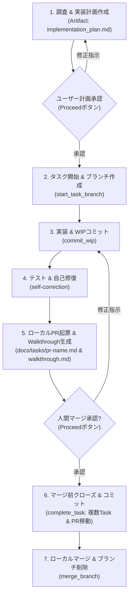

# ローカル開発ワークフロー規定 (Local Task Workflow)

本ドキュメントは、GitHub PR やリモート連携を使用せず、ローカル環境単体で安全かつ確実に開発サイクル（タスク文書管理、作業ブランチ運用、テスト自己修復、ローカルPR起票、人間承認後のマージ、タスク完了記録）を推進するためのワークフローである。`/AI Development Workflow` の規約とライフサイクルを踏襲し、完全ローカル環境向けに最適化している。

> [!IMPORTANT]
> - **共通行動規範（SSOT）**: 言語・エンコード（日本語・UTF-8）、調査と変更の分離、Ponytail最小構成等の常時行動制約は [AGENTS.md](../../../AGENTS.md) を正本として厳守すること (**MUST**)。
> - **不可侵ガードレール（ブランチ保護）**: コードや仕様書を1文字でも編集する前に、必ず作業ブランチに切り替えること (**MUST**)。baseブランチ（`main` 等）上での直接編集・直接コミットは絶対禁止 (**MUST NOT**)。
> - **Artifacts原則**: 実装計画書（`implementation_plan.md`）および完了報告（`walkthrough.md`）は必ず Antigravity Artifacts ディレクトリ（`<appDataDir>\brain\<conversation-id>\`）に出力し、チャット本文への長大な全文再要約・二重出力を禁じる (**MUST NOT**)。
> - **承認なきマージの禁止**: テストが全件通過しても、人間にWalkthroughを提示して明示的なマージ承認（Proceedボタンまたはチャット承認）を得る前に、勝手にbaseブランチへマージしてはならない (**MUST NOT**)。

---

## ワークフロー全体図 (Local Lifecycle Overview)



---

## 1. 調査と実装計画書（Artifact: implementation_plan.md）

* **調査と要求分析**:
  * 関連仕様書（`docs/spec/spec-router.md`）やコードを調査し、変更対象と受入条件を特定する。
* **実装計画書の Artifact 出力**:
  * `write_file` を用い、`<appDataDir>\brain\<conversation-id>\implementation_plan.md` に計画書を作成する。
  * `ArtifactMetadata` には `UserFacing: true`, `RequestFeedback: true` を指定し、UI上に「Proceed」ボタンを表示させる。
* **チャット案内ルール**:
  * チャット本文で計画全文を再要約せず、Artifact へのファイルリンクと判断・確認が必要な論点のみを簡潔に提示してユーザーの承認を仰ぐ。

---

## 2. タスク開始と作業ブランチ作成

* **タスク文書の初期化とブランチ作成 (MUST)**:
  * 計画承認後直ちに専用スクリプトを実行し、`docs/tasks/<task>.md` の生成（初回は `docs/tasks/` も自動作成）と作業ブランチの作成・チェックアウトを一括実行する。
  * **複数タスクの扱い**: 1つのブランチで複数のタスクを解消する場合は、主タスク名でブランチを作成し、追加のタスク文書は `docs/tasks/` 配下に作成・追記する。
  * **タイトル規約**: タイトルに `[AI]` や絵文字等の接頭辞（Prefix）は付けず、クリーンな日本語タイトルとする (**MUST**)。
  * **AI識別ラベル**: 生成されるタスク文書の Frontmatter に `labels: ["ai-generated"]` が含まれる (**MUST**)。
  * **共通フッター**: 本文末尾に共通フッター（`<sub>Generated with AI Agent ({{HARNESS_NAME}})</sub>`、ハーネス名を反映）を含める (**MUST**)。
  ```bash
  python .agents/skills/local-workflow/scripts/start_task_branch.py -t 001-task-name --title "タスクの日本語タイトル"
  ```
* **タスク仕様の明確化**:
  * 生成された `docs/tasks/<task>.md` 内の Goal、Context、Technical Details、Verification を確認・補完する。

---

## 3. 実装とWIPコミット（セーブポイント）

* **WIPコミットとシークレットガード**:
  * 作業ブランチ上での自律的なWIPコミットは許可される。APIキーや秘密鍵の流出を100%機械的に阻止するため、必ず専用スクリプトを使用すること。
  * 差分全体ではなく特定のファイルのみを対象とする場合は `-p / --paths` で指定可能。
  ```bash
  python .agents/skills/local-workflow/scripts/commit_wip.py -m "作業内容の説明" -t 001-task-name
  # パス指定コミット:
  # python .agents/skills/local-workflow/scripts/commit_wip.py -m "作業内容の説明" -t 001-task-name -p path/to/file1 path/to/file2
  ```
* **ブランチ保護**:
  * baseブランチ（`main` 等）への直接編集・直接コミットは絶対禁止 (**MUST NOT**)。必ず作業ブランチ上で行うこと。

---

## 4. 自律テスト・品質検証と自己修復 (Self-Correction)

* **自律的な品質検証**:
  * コード・仕様修正後、仕様書整合性検証（`python .agents/skills/spec-verification/scripts/verify_specs.py`）およびプロジェクト固有の標準テスト・Linter（`npm test`, `pytest`, `cargo test` 等）を実行する (**MUST**)。
* **自己修復プロトコル**:
  * エラー発生時は最大3回まで自律修復を試みる。巨大ログ抑制テクニックや詳細な手順は [**references/self-correction.md**](references/self-correction.md) を参照すること。

---

## 5. 差分要約とローカルPR起票・Walkthrough生成

`/AI Development Workflow` を踏襲し、人間へのレビュー要請としてローカル PR 文書と Walkthrough を作成する。

* **差分サマリー抽出**:
  ```bash
  python .agents/skills/local-workflow/scripts/generate_walkthrough.py
  ```
* **Walkthrough の Artifact 出力**:
  * 差分要約およびテスト実行エビデンス（PASSログ）を統合し、`<appDataDir>\brain\<conversation-id>\walkthrough.md` を作成する（`UserFacing: true`, `RequestFeedback: true` でマージ承認を要請）。
* **ローカルPR文書の作成 (推奨)**:
  * テンプレート（`.agents/skills/local-workflow/resources/PR_TEMPLATE.md`）に準拠し、解決するタスク（`Closes 001-task.md, 002-task.md`）を明記した `docs/tasks/pr-<name>.md` を起票する。
  * チャット上ではエビデンス概要とリンクのみを提示し、マージ確認を求める。

---

## 6. 承認後クローズ処理とローカルマージ

人間から承認（Proceedボタンまたはチャットでの承認）を受けた後、以下のステップを順次実行する。

1. **マージ前クローズ処理とコミット（作業ブランチ上）**:
   * マージ前に必ず作業ブランチ上で、指定された全タスク文書（複数可）および PR 文書のステータスを更新し、`docs/tasks/completed/` に一括移動する。
   * Artifact の `walkthrough.md` を指定して PR 文書へ検証エビデンスを自動流し込み可能。
   ```bash
   # 単一タスクの場合:
   python .agents/skills/local-workflow/scripts/complete_task.py -t 001-task-name.md --walkthrough-file "<appDataDir>/brain/<conversation-id>/walkthrough.md"
   
   # 複数タスクを1つのPRで一括解消する場合:
   python .agents/skills/local-workflow/scripts/complete_task.py -t 001-setup-auth.md 002-login-ui.md --pr-name pr-auth-system --walkthrough-file "<appDataDir>/brain/<conversation-id>/walkthrough.md"
   
   # 作業ブランチ上で一括コミット:
   python .agents/skills/local-workflow/scripts/commit_wip.py -m "docs: resolve tasks via PR pr-auth-system" -t 001-setup-auth
   ```
2. **ローカルマージとブランチ削除**:
   * マージスクリプトにより、baseブランチへの切り替え、マージ（コード・複数タスク完了・PR文書が一括で取り込まれる）、作業ブランチの削除を一括実行する。
   ```bash
   python .agents/skills/local-workflow/scripts/merge_branch.py -b task/001-task-name
   ```
   * 詳細なライフサイクル運用は [**references/local-lifecycle.md**](references/local-lifecycle.md) を参照すること。
