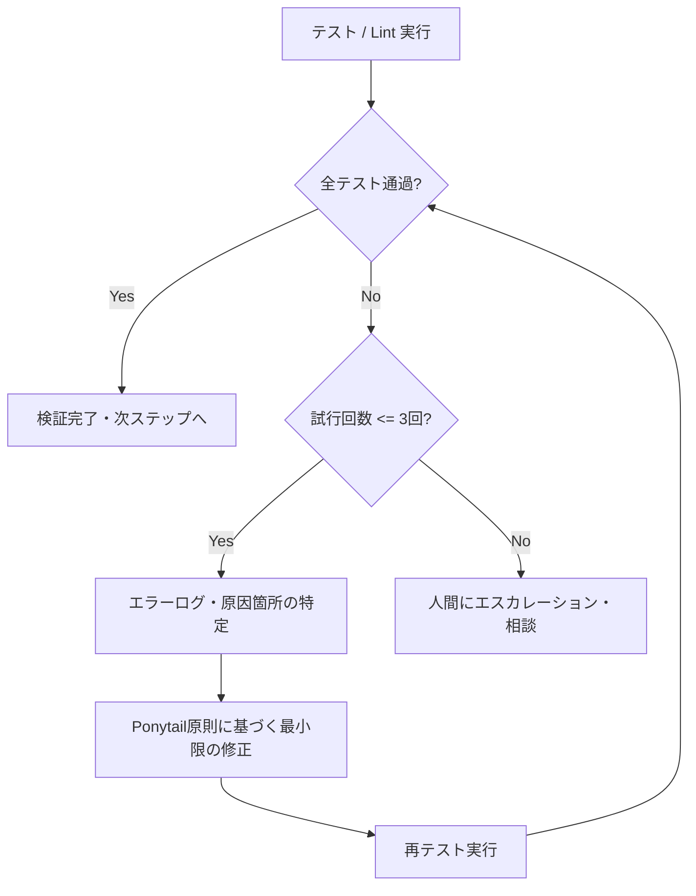

# 自己修復テスト・品質検証ガイド (Self-Correction Guide)

本ドキュメントは、ローカル開発におけるコード変更後のビルド・テスト・Lint検証および、エラー発生時の自己修復（Self-Correction）プロトコルの詳細規定である。

---

## 1. プロジェクト標準コマンドの自律検知

エージェントは、プロジェクト固有のビルド・テスト用スクリプトを固定的に呼び出すのではなく、**リポジトリ内の構成ファイルを読み取り、その言語・フレームワークに最適なコマンドを自律的に判断・実行**する。

| 対象言語 / 環境 | 判定基準ファイル | 標準的なテスト・Lintコマンド例 |
| :--- | :--- | :--- |
| **Node.js / TypeScript** | `package.json` | `npm test` / `npm run lint`（または `pnpm test`, `yarn test`, `bun test`） |
| **Python** | `pyproject.toml`, `requirements.txt`, `pytest.ini` | `pytest` / `ruff check`（または `flake8`, `mypy`） |
| **Rust** | `Cargo.toml` | `cargo test` / `cargo clippy` |
| **Go** | `go.mod` | `go test ./...` / `golangci-lint run` |
| **Java / Kotlin** | `build.gradle*`, `pom.xml` | `./gradlew test` / `mvn test` |
| **汎用・その他** | `Makefile`, `Taskfile.yml` | `make test` / `task test` |

> [!IMPORTANT]
> - `docs/core-rules.md` や `docs/system/tech-stack.md`、`docs/components/*.md` に固有の検証コマンドやテスト実行要件が記載されている場合は、それを最優先で遵守すること。
> - 特殊な構成がある場合は、`package.json` の `"scripts"` やローカルの設定ファイルを確認して実行コマンドを特定する。

---

## 2. トークン爆発防止と巨大ログ抑制テクニック

ビルドやテストのエラーログは数千〜数万行に達することがあり、生のログ全文をそのままコンテキストに読み込むと急激なトークン枯渇を招く。エージェントは以下の工夫を行い、最小限のコンテキストで効率的に原因を特定すること。

1. **差分に基づくテストの絞り込み (Incremental Test)**:
   - 全体テストを実行する前に、変更されたファイルに関連する単体テストのみを実行できる場合はそれを優先する（例: `npm test -- path/to/changed.test.ts`、`pytest tests/test_changed.py`）。
2. **エラー行・スタックトレースの限定取得**:
   - 巨大なビルドログが出力される場合は、パイプラインやフィルタを活用してエラー箇所を絞り込む。
     - PowerShell: `npm test 2>&1 | Select-String -Pattern "error", "fail", "assert" -Context 2, 5`
     - bash: `npm test 2>&1 | grep -E "FAIL|ERROR" -A 5 -B 2`
3. **一時ファイルへの退避と部分読込**:
   - ログが長大になりそうな場合は一時ファイル（例: `test_output.log`）に出力し、`read_file` 等で末尾（エラー発生箇所）のみをピンポイントで確認する。確認後は速やかに一時ログを削除する。

---

## 3. Self-Correction（自己修復）プロトコル

テストやLintが失敗した場合、エージェントは以下のフローに従って自律修復を試みる。

### 遵守事項:
1. **試行回数上限（最大3回）**:
   - 自己修復の試行は **最大3回** までとする。
   - 3回修正しても解決しない場合は、泥沼化・ハルシネーションを防ぐため、作業を中断して人間に具体的なエラー内容と現在の仮説を報告し、指示を仰ぐこと。
2. **Ponytail原則の徹底**:
   - テストを通すために仕様書にない不要な抽象化やワークアラウンドを付け足してはならない。
   - 最もシンプルかつ本質的な最小差分で修正すること。
3. **仕様・テストのサイレント改変禁止**:
   - 実装エラーを隠蔽するために、既存のテストのアサーションを勝手に緩めたり、テストケースを削除してはならない (**MUST NOT**)。
