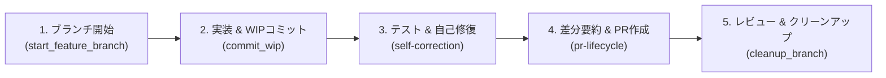

# AI開発ワークフロー規定 (AI Development Workflow)

本ドキュメントは、プロジェクトにおけるAIエージェントの開発ライフサイクル全体を統括する標準ワークフローである。詳細な技術手順や運用規則は、Progressive Disclosure（段階的情報開示）に基づき `references/` 配下の各リファレンスを参照すること。

> [!IMPORTANT]
> - **成果物言語**: AIが作成する成果物ドキュメント（Implementation Plan、Walkthrough、PR本文、Issue等）は、原則として**日本語**で記述すること。
> - **調査と実装の分離**: ユーザー指示が「確認・調査」である場合はコードやドキュメントを変更せず結果報告に留めること。変更作業は、事前に明示的な修正指示と実装計画の承認を得てから作業ブランチ上で行うこと。
> - **Ponytail原則**: 仕様書にない不要な抽象化や過剰なボイラープレートを排除し、最短・最善の最小差分で実装すること。

---

## ワークフロー全体図 (Lifecycle Overview)



---

## 1. 作業ブランチ作成とWIPコミット

* **作業ブランチの作成**:
  * 最新のベースブランチ（`main` 等）から作業ブランチを作成する。未コミット変更がある場合は `--auto-stash` を付与可能。
  ```bash
  python .agents/skills/workflow/scripts/start_feature_branch.py -b feature/issue-XXX-description
  ```
* **WIP（セーブポイント）コミットとシークレットガード**:
  * 作業ブランチ上での自律的なWIPコミットは許可される。APIキーや秘密鍵の流出を100%機械的に阻止するため、必ず専用スクリプトを使用すること。
  ```bash
  python .agents/skills/workflow/scripts/commit_wip.py -m "作業内容の説明" -i XXX
  ```
* **ブランチ保護**:
  * `main` への直接Pushおよびコミット履歴を改変する `git push --force` (`-f`) は絶対禁止 (**MUST NOT**)。

---

## 2. 実装・不可侵検証と自己修復 (Self-Correction)

* **自律的な品質検証**:
  * コード修正後、Walkthrough作成や報告を行う前に、プロジェクト固有の標準テストおよびLinter（`npm test`, `pytest`, `cargo test` 等）を自律判定して実行する。
* **自己修復プロトコル**:
  * テストやLintが失敗した場合は、最大3回まで自律修復を試みる。
  * 巨大ログによるトークン消費を防ぐログ抑制テクニックや詳細な手順は [**references/self-correction.md**](references/self-correction.md) を参照すること。

---

## 3. サブエージェントの協調 (Manager / Worker)

* **タスクの委任**:
  * 大規模・複雑なタスクでは、調査や部分実装をサブエージェントに委任して並列処理を行う。
* **安価モデル（Flash）の指定義務**:
  * リサーチや単純ファイル検索、ログ解析等のサブエージェントを起動する際は、コスト最適化のため `flash` または `flash_lite` を指定すること。

---

## 4. Definition of Done & PR作成・クリーンアップ

* **DoDチェックリスト & 差分要約**:
  * PR作成前に、ドキュメント整合性・テスト通過・派生課題の起票準備を確認する。
  * `generate_walkthrough.py` でトークン消費を抑えた差分サマリーを取得する。
  ```bash
  python .agents/skills/workflow/scripts/generate_walkthrough.py
  ```
* **PR起票・レビュー対応・マージ後クリーンアップ**:
  * PRテンプレート（`resources/PULL_REQUEST_TEMPLATE.md`）の適用、MCPツールを用いたPR作成、およびマージ後の `cleanup_branch.py` によるブランチ消去・同期の詳細手順は [**references/pr-lifecycle.md**](references/pr-lifecycle.md) を参照すること。
