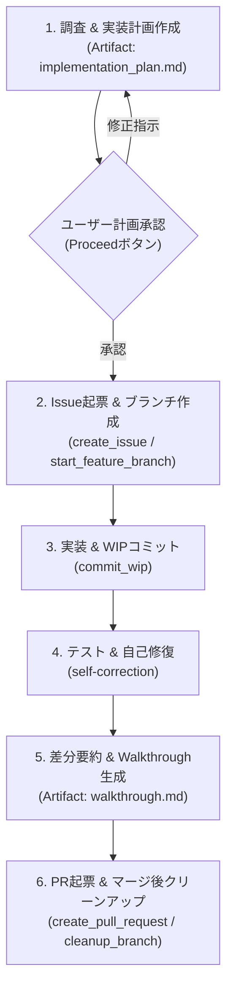

# AI開発ワークフロー規定 (AI Development Workflow)

本ドキュメントは、プロジェクトにおけるAIエージェントの開発ライフサイクル全体を統括する標準ワークフローである。詳細な技術手順や運用規則は、Progressive Disclosure（段階的情報開示）に基づき `references/` 配下の各リファレンスを参照すること。

> [!IMPORTANT]
> - **共通行動規範（SSOT）**: 言語・エンコード（日本語・UTF-8）、調査と変更の分離、Ponytail最小構成等の常時行動制約は [AGENTS.md](../../../AGENTS.md) を正本として厳守すること (**MUST**)。
> - **不可侵ガードレール（ブランチ保護）**: コードや仕様書を1文字でも編集する前に、必ず作業ブランチに切り替えること (**MUST**)。baseブランチ（`main` 等）上での直接編集・直接コミット・直接Pushは絶対禁止 (**MUST NOT**)。
> - **Artifacts原則**: 実装計画書（`implementation_plan.md`）および完了報告（`walkthrough.md`）は必ず Antigravity Artifacts ディレクトリ（`<appDataDir>\brain\<conversation-id>\`）に出力し、チャット本文への長大な全文再要約・二重出力を禁じる (**MUST NOT**)。

---

## ワークフロー全体図 (Lifecycle Overview)



---

## 1. 調査と実装計画書（Artifact: implementation_plan.md）

* **調査と要求分析**:
  * 関連仕様書（`docs/spec-router.md`）やコードを調査し、変更対象と受入条件を特定する。
* **実装計画書の Artifact 出力**:
  * `write_file` を用い、`<appDataDir>\brain\<conversation-id>\implementation_plan.md` に計画書を作成する。
  * `ArtifactMetadata` には `UserFacing: true`, `RequestFeedback: true` を指定し、UI上に「Proceed」ボタンを表示させる。
* **チャット案内ルール**:
  * チャット本文で計画全文を再要約せず、Artifact へのファイルリンクと判断・確認が必要な論点のみを簡潔に提示してユーザーの承認を仰ぐ。

---

## 2. GitHub Issue起票と作業ブランチ作成

* **GitHub Issue の起票 (MUST)**:
  * 既存Issue番号（例: `#42`）が指定されていない場合、計画承認後直ちに [.agents/skills/workflow/resources/ISSUE_TEMPLATE.md](resources/ISSUE_TEMPLATE.md) のフォーマットに従って GitHub Issue を起票する。
  * **タイトル規約**: タイトルに `[AI]` や絵文字等の接頭辞（Prefix）は付けず、クリーンなConventional Commitsまたは日本語タイトルとする (**MUST**)。
  * **AI識別ラベル**: 必ず `--label "ai-generated"` を付与して起票する (**MUST**)。
  * **共通フッター**: 本文末尾にテンプレート規定の共通フッター（`<sub>Generated with AI Agent ({{HARNESS_NAME}})</sub>`、実行環境のハーネス名を反映）を含める (**MUST**)。
  * MCPツール `create_issue` または `gh issue create --title "..." --body-file "..." --label "ai-generated"` を使用し、採番されたIssue番号を取得する。
* **作業ブランチの作成 (MUST)**:
  * 取得したIssue番号に基づき、専用スクリプトで最新のベースブランチ（`main` 等）から作業ブランチを作成・チェックアウトする（ブランチ名にも接頭辞は付与しない）。
  ```bash
  python .agents/skills/workflow/scripts/start_feature_branch.py -b feature/issue-XXX-description
  ```
* **作業前検証**:
  * `git branch --show-current` で作業ブランチに切り替わっていることを確認してから実装・編集に着手する。

---

## 3. 実装とWIPコミット（セーブポイント）

* **WIPコミットとシークレットガード**:
  * 作業ブランチ上での自律的なWIPコミットは許可される。APIキーや秘密鍵の流出を100%機械的に阻止するため、必ず専用スクリプトを使用すること。
  * 差分全体ではなく特定のファイルのみを対象とする場合は `-p / --paths` で指定可能。
  ```bash
  python .agents/skills/workflow/scripts/commit_wip.py -m "作業内容の説明" -i XXX
  # パス指定コミット:
  # python .agents/skills/workflow/scripts/commit_wip.py -m "作業内容の説明" -i XXX -p path/to/file1 path/to/file2
  ```
* **ブランチ保護**:
  * `main` への直接Pushおよびコミット履歴を改変する `git push --force` (`-f`) は絶対禁止 (**MUST NOT**)。

---

## 4. テスト・不可侵検証と自己修復 (Self-Correction)

* **自律的な品質検証**:
  * コード・仕様修正後、Walkthrough作成やPR起票を行う前に、仕様書整合性検証（`python .agents/skills/spec-verification/scripts/verify_specs.py`）およびプロジェクト固有の標準テスト・Linter（`npm test`, `pytest`, `cargo test` 等）を実行する (**MUST**)。
* **自己修復プロトコル**:
  * テストやLintが失敗した場合は、最大3回まで自律修復を試みる。
  * 巨大ログによるトークン消費を防ぐログ抑制テクニックや詳細な手順は [**references/self-correction.md**](references/self-correction.md) を参照すること。

---

## 5. 差分要約とWalkthrough（Artifact: walkthrough.md）

* **差分サマリー抽出**:
  * `generate_walkthrough.py` でトークン消費を抑えた差分サマリーを取得する。
  ```bash
  python .agents/skills/workflow/scripts/generate_walkthrough.py
  ```
* **Walkthrough の Artifact 出力**:
  * 差分要約およびテスト実行エビデンス（PASSログ）を統合し、`<appDataDir>\brain\<conversation-id>\walkthrough.md` を作成する（`UserFacing: true`, `RequestFeedback: false`）。
  * チャット上ではエビデンス概要とリンクのみを提示する。

---

## 6. PR起票・レビュー対応・マージ後クリーンアップ

* **PRテンプレートとIssue連携**:
  * PR作成時は [.agents/skills/workflow/resources/PULL_REQUEST_TEMPLATE.md](resources/PULL_REQUEST_TEMPLATE.md) を適用し、本文末尾に `Closes #XXX` を含めてIssueと自動連動させる。
  * **タイトル規約**: PRタイトルに接頭辞（Prefix）は付けず、クリーンなConventional Commitsとする (**MUST**)。
  * **AI識別ラベル**: 必ず `--label "ai-generated"` を付与してPRを作成する (**MUST**)。
  * **共通フッター**: 本文末尾にテンプレート規定の共通フッター（`<sub>Generated with AI Agent ({{HARNESS_NAME}})</sub>`、実行環境のハーネス名を反映）を含める (**MUST**)。
* **詳細手順の参照**:
  * MCPツールを用いたPR作成、対話的レビュー対応、およびマージ後の `cleanup_branch.py` によるブランチ消去・同期の詳細手順は [**references/pr-lifecycle.md**](references/pr-lifecycle.md) を参照すること。
