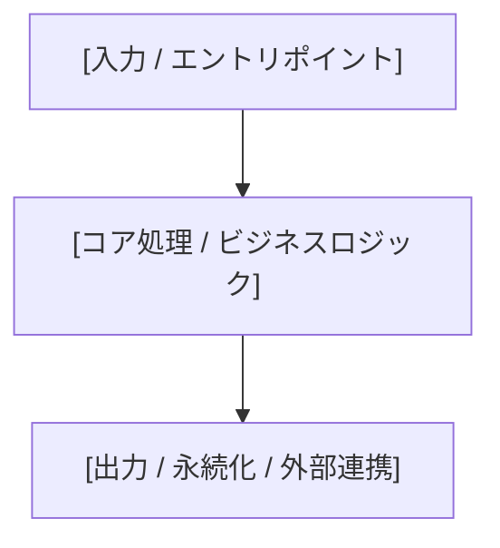

# {{PROJECT_NAME}} - システム概要 (overview.md)
<!-- @spec:system-architecture -->

本ドキュメントは、プロジェクト全体の**目的、システム境界、アーキテクチャ構成、および技術スタック**を規定する仕様正本（SSOT）である。

---

## 1. プロジェクト目的・背景 (Purpose & Background)
<!-- @spec:system-purpose -->

### 1.1 解決する課題 (Problem Statement)
* <!-- 既存の運用やシステムで何が問題・ボトルネックになっているかを記述 -->
* 

### 1.2 目標と提供価値 (Goals & Value Proposition)
* <!-- 本システム/ツールの導入によって達成されるゴールを箇条書きで記述 -->
* 

### 1.3 成功指標 (Success Metrics / KPIs)
* <!-- 定量的な性能基準、品質目標、達成基準などを記述 -->
* 

---

## 2. スコープ定義 (Scope)
<!-- @spec:system-scope -->

### 2.1 In-Scope（対象範囲）
* [本システムが提供・担当する中核領域]
* 

### 2.2 Out-of-Scope（対象外）
* <!-- 本システムでは対応しない範囲、将来検討、外部に委ねる境界を明記 -->
* 

---

## 3. システムアーキテクチャ (Architecture)
<!-- @spec:system-architecture-diagram -->

### 3.1 コンポーネント構成 ＆ 依存関係
<!-- Mermaid等で主要コンポーネント間の境界と単方向依存を可視化 -->

| コンポーネント | 配置パス | 主な責務 | 依存先 |
|:---|:---|:---|:---|
| `[コンポーネントA]` | `src/...` | `[主な責務]` | `[コンポーネントB]` |
| `[コンポーネントB]` | `src/...` | `[主な責務]` | なし |

### 3.2 外部境界 ＆ データフロー概要
* **外部入力**: [ユーザー操作、CLI引数、APIリクエスト、外部データソース等]
* **外部出力 / 永続化**: [画面表示、標準出力、ファイル、DB、外部サービス等]
* **主要データフロー**: [入力が処理され、出力に至る基本フロー]

---

## 4. 技術スタック ＆ 動作環境 (Tech Stack)
<!-- @spec:system-tech-stack -->

* **言語 / ランタイム**: [例: Python 3.12+ / Node.js 20+ / Rust 1.75+ 等]
* **主要ライブラリ**: [プロジェクトで採用する主要パッケージ]
* **実行環境**: [例: ローカルCLI, Dockerコンテナ, サーバー等]

---

## 5. ドメイン用語集 (Glossary)
<!-- @spec:system-glossary -->

プロジェクト内で認識齟齬を防ぐための共通語彙（ユビキタス言語）の定義である。

| 用語 (日本語 / 英語) | 定義・責務 | 注意点・別名との違い |
|:---|:---|:---|
| `[用語 A]` | [何を表す概念・データか] | [混同しやすい別用語との差異] |
| `[用語 B]` | [何を表す概念・データか] | [混同しやすい別用語との差異] |
